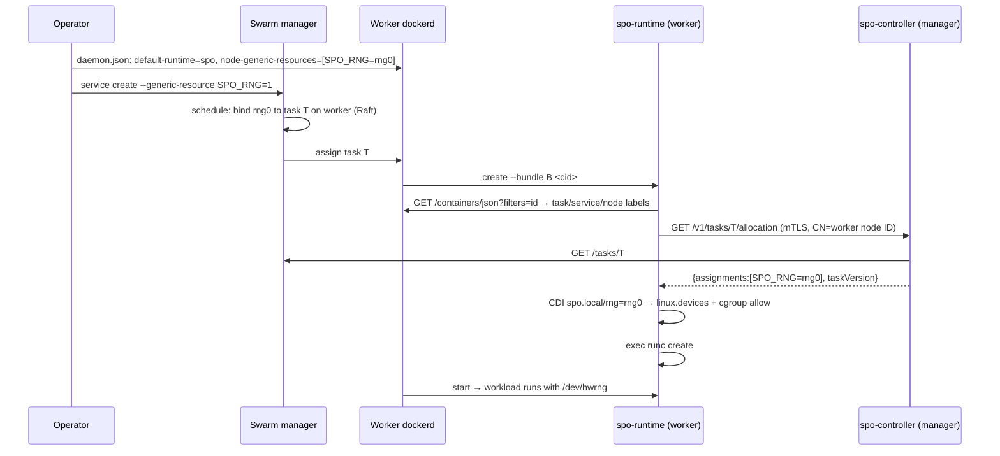

# Architecture overview

SPO gives Swarm tasks host devices without privileged containers. Swarm still owns placement, binding, and lifecycle. SPO turns Swarm's binding into device access before the workload starts.

Decisions: [ADR 0001](../adr/0001-runtime-integration.md), [ADR 0002](../adr/0002-allocation-coordination.md). Status: Phase 0, gated by #1.

## Components

| Component | Runs on | Phase 0 state | Role |
|---|---|---|---|
| `spo-runtime` | every node, as dockerd `default-runtime` | PoC | On `create`, resolve the task, fetch its assignment, inject CDI devices, exec runc |
| `spo-controller` | managers, as a Swarm service | PoC | Serve task assignments from the manager API over mTLS |
| `spo-agent` | every node | planned (#9-#11) | Discover devices, write CDI specs, compute `node-generic-resources` |
| `spo` | operator host | planned (#12) | Inventory, validation, diagnostics |
| plugins | inside agent | planned | Per-class discovery and CDI generation (NVIDIA uses `nvidia-ctk`) |

## Flow

## Responsibilities

| Concern | Owner |
|---|---|
| Placement eligibility, exclusive binding, release | Swarm scheduler (named generic resources) |
| Task → assignment lookup | `spo-controller` |
| Device edits, policy, fail-closed | `spo-runtime` |
| Inventory, CDI specs, advertisement | `spo-agent` (planned). Static config in Phase 0. |

## Not supported (Phase 0)

- Shareable, partitioned, and capacity-based classes ([ADR 0002](../adr/0002-allocation-coordination.md) L2).
- Hotplug without a dockerd restart (L3).
- cgroup v1 hosts, rootless Docker, and Docker Desktop as a production target. None are tested.
- Real GPU and USB hardware. Not yet exercised (#8).
